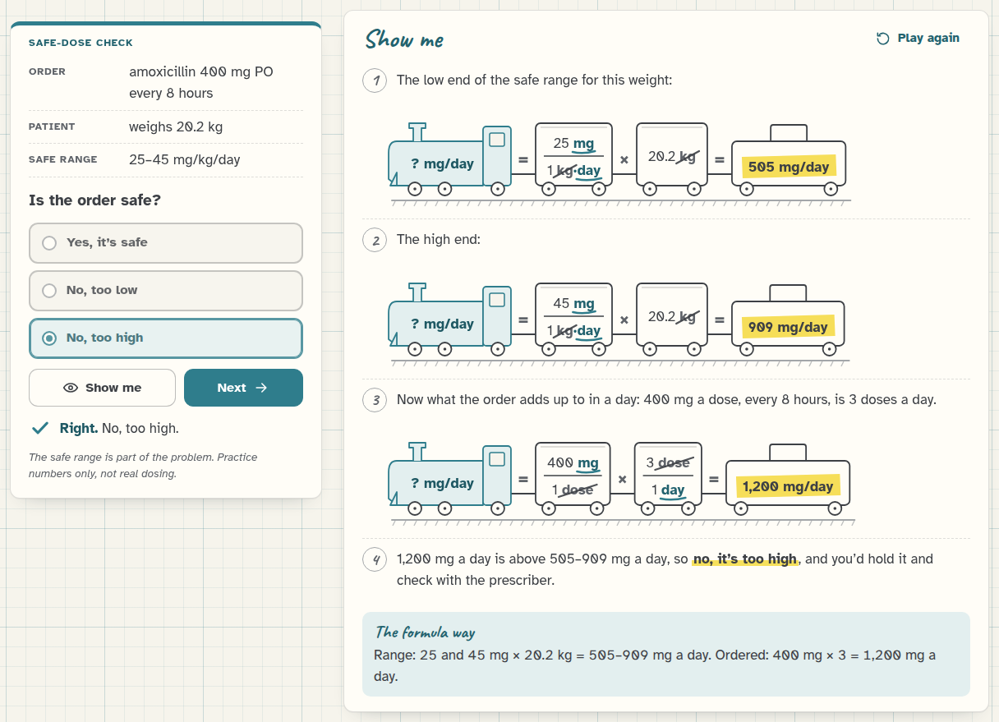
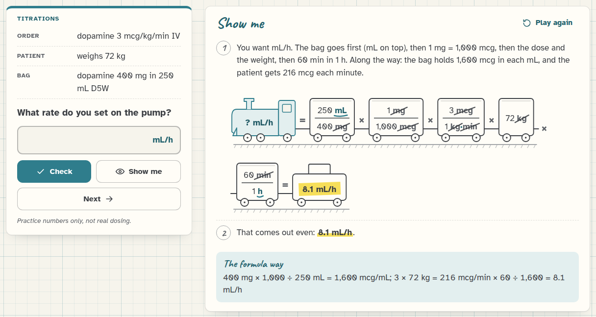
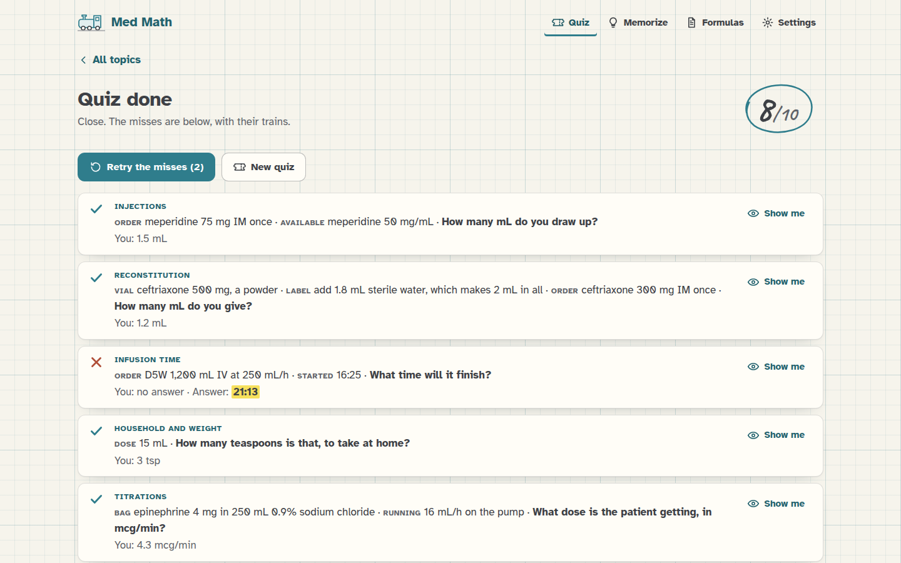
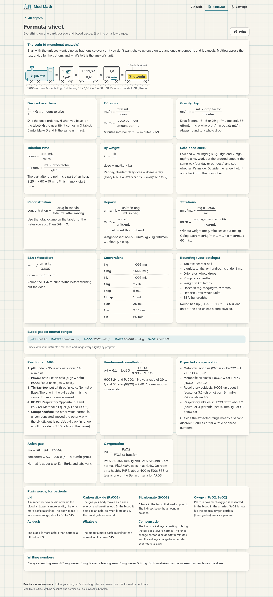
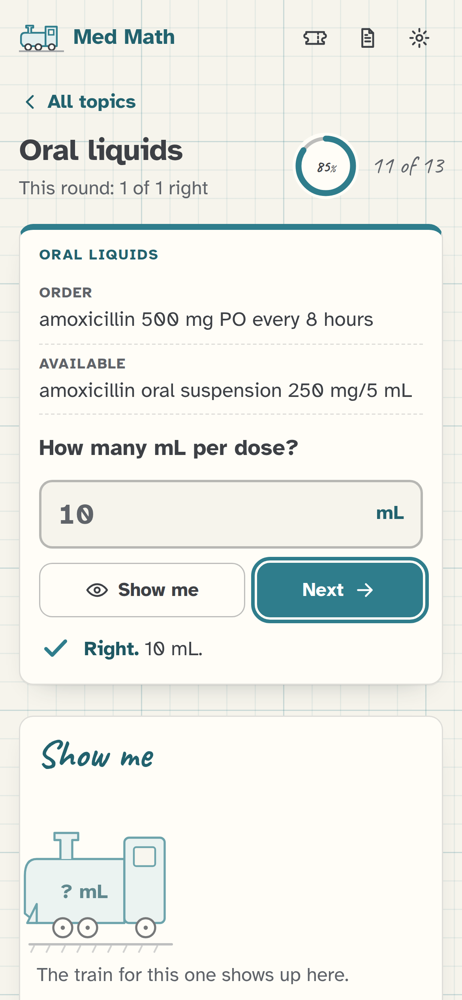
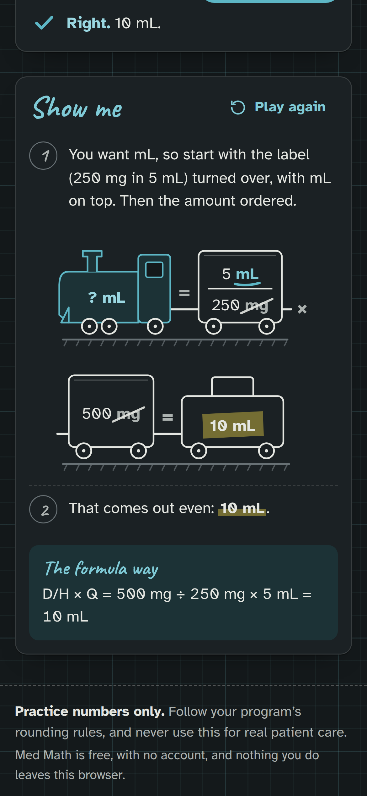

  

<h1 align="center">Med Math</h1>

<b>Dosage calculation and blood gas practice for nursing students, with every answer worked out step by step.</b> Each answer is drawn as a little train of fractions, and you watch the units cancel.

  
  
  
  
  
  

  <a href="docs/README.md"><b>Docs</b></a> ·
  <a href="#use-it">Use it</a> ·
  <a href="#what-it-does">What it does</a> ·
  <a href="#screenshots">Screenshots</a> ·
  <a href="docs/the-train.md">How the train works</a> ·
  <a href="docs/blood-gases.md">Blood gases</a>

<picture>
  <source media="(prefers-color-scheme: dark)" srcset="docs/images/practice-dark.png">
  
</picture>

Med Math is free, endless practice for the dosage calculations nursing students get tested on: tablets, liquids,
injections, drip rates, heparin, titrations and the rest. Every problem reads like a real order, and every answer
comes with a "Show me" that works it out the way nursing courses teach it, as a chain of fractions where the units
cancel. I draw that chain as a train on graph paper, which means you can actually SEE why the answer comes out in
mL/h and not in mg. There's also a whole section on arterial blood gases, from reading an ABG to explaining the
results to a patient in plain words.

## Why I made it

Dosage calculation exams are one of those things nursing students worry about a lot, and for good reason: the pass
mark is often 90% or even 100%, because a wrong decimal point on the job is a wrong dose. The free practice I found
was either a page of answers with no working, or a handful of problems and then a paywall, and not much of it
showed the dimensional analysis that the courses actually use.

So I made one that never runs out of problems and always shows its work. Since a wrong answer key in a study tool is
worse than no tool at all, every answer in Med Math is worked out twice, two different ways, and a test checks that
both ways agree on thousands of problems before anything goes live. Basically, it's the practice book I'd want if I
had that exam coming up.

## What it does

### Practice
- **14 topics.** Metric conversions, household and weight conversions, tablets and capsules, oral liquids,
  injections, reconstitution, weight-based doses, safe-dose checks, BSA dosing, IV pump rates, gravity drip rates,
  infusion and finish times, heparin, and titrations.
- **Endless problems** that read like real orders ("Order: amoxicillin 500 mg PO every 8 hours. Available: 250 mg/5 mL.
  How many mL per dose?"), with numbers picked to be realistic and clean.
- **Check, Show me, Next.** The answer box shows its unit, Enter checks, and Enter again goes on. A wrong answer
  tells you the right one and offers "Show me".
- **Fair about rounding.** It accepts 0.5, .5, 1/2 and ½, an answer written with a few more decimals than needed, and
  the answer you get when you don't round the weight first.

### Blood gases
- **Read the ABG** by tic-tac-toe and ROME: normal, acidosis or alkalosis, respiratory, metabolic or mixed, and how
  compensated, with the normal ranges on every problem and "Show me" walking through the grid.
- **Oxygenation:** PaO2 and SaO2, and the P/F ratio with FiO2 as a fraction.
- **The equation:** Henderson-Hasselbalch, pH = 6.1 + log10(HCO3 ÷ (0.03 × PaCO2)), as a train where the units cancel.
- **Expected compensation:** Winters' formula and the other rules of thumb, to spot a second disorder.
- **Anion gap,** and the albumin-corrected gap, drawn as two columns of charges.
- **Talk it through:** bedside moments where you pick the best thing to say to a patient or family member, with why
  each option works or doesn't, a model answer, and a plain-words glossary. It's communication practice, never
  treatment advice.
- **A blood gas quiz** of its own, and every random ABG fits the Henderson-Hasselbalch equation, like a real one.

### Show me
- **The fraction train.** The engine carries the unit you want, each fraction is a car, the units that cancel get
  struck through in pencil, and the caboose carries the answer under a highlighter.
- **Step by step,** with the rounding said in words ("31.25 gtt/min, rounded to whole drops: 31 gtt/min") and the
  same answer worked "the formula way" underneath (D/H × Q, mL × drop factor ÷ minutes, and so on).
- **Animated,** car by car, and drawn all at once if your device asks for less motion.

### Quiz, formulas, settings
- **Mixed quiz:** 10 problems from the topics you choose, a score at the end, the train for each one, and "Retry the
  misses" with the same numbers.
- **Formula sheet:** one printable card with every formula, the conversions, your rounding rules, and the blood gas
  ranges, rules and plain words.
- **Settings:** liquid, pump-rate and weight rounding, 2.2 or 2.2046 lb in a kg, a 24-hour or 12-hour clock, and
  which topics (and whether the blood gas ones) go into the mixed quiz.
- **Progress:** right out of total for each topic, as a ring on the home screen, plus your last 50 answers.

## Screenshots

<picture>
  <source media="(prefers-color-scheme: dark)" srcset="docs/images/home-dark.png">
  
</picture>

*The home screen, with the topics as four lines and a ring for how you're doing on each.*

More screenshots

*Reading an ABG: the pH and the HCO3 line up in the Acid column, so it's metabolic.*

*Talk it through: practice for explaining it to a patient.*

*A weight-based dose. First the pounds become kg, then the dose train.*

*A safe-dose check. The safe range is part of the problem.*

*A titration. Long trains go on to a second track.*

*BSA by Mosteller, where the train runs under the square root.*

*The end of a quiz.*

*The formula sheet, ready to print.*

  
  

*On a phone, in light and dark.*

## Use it

Open **https://stuffs.tiresia.xyz/med-math/** in any up-to-date browser, on a phone, a tablet or a computer. It's
free, there's no account and no sign-in, and nothing you do leaves your browser: your progress and settings are kept
in the browser itself. On an iPhone or iPad you can tap **Share** and then **Add to Home Screen** to give it its own
icon.

One thing to keep in mind: these are PRACTICE numbers. The drug names are real generics to make the problems feel
real, but the doses and safe ranges are made up for practice. Follow your own program's rounding rules, check with
your instructor (methods and ranges vary slightly by program), and never use Med Math for real patient care.

## Documentation

The docs explain everything Med Math does, in order:

- **Getting started:** [What is Med Math?](docs/what-is-med-math.md)
- **Using it:** [Practicing a topic](docs/practice.md), [How the train works](docs/the-train.md) and
  [The quiz and the formula sheet](docs/quiz-and-formulas.md)
- **Blood gases:** [Blood gases](docs/blood-gases.md), with the sources
- **Reference:** [The 14 topics](docs/topics.md) and [Settings](docs/settings.md)
- **Under the hood:** [Developing](docs/DEVELOPING.md)

Start with [What is Med Math?](docs/what-is-med-math.md)

## How it's built

Plain HTML, CSS and JavaScript modules, with no framework and no build step. The page is in `app/`.

| File | What |
|---|---|
| `app/js/topics.js` | The 14 dosage problem makers. Each picks the numbers, writes the order and builds the train. |
| `app/js/abg.js`, `app/js/talk.js` | The six blood gas topics, and the "Talk it through" cards and glossary. |
| `app/js/abgview.js` | The tic-tac-toe grid, the number line, the anion gap columns and the talk card review. |
| `app/js/frac.js`, `train.js`, `rules.js` | Exact fractions, multiplying the train out and cancelling units, and the rounding rules. |
| `app/js/formulas.js` | The second, independent way of working every answer, with plain formulas (and ROME for ABGs). |
| `app/js/answer.js` | Reading what you typed (0.5, .5, 1/2, 7:30 PM) and deciding if it's right. |
| `app/js/trainview.js` | Drawing the train as SVG, and animating it. |
| `app/js/main.js`, `app/style.css` | The screens, and the notebook look in light and dark. |
| `tools/test.py`, `tools/test.html` | The answer-key tests, run in headless Chrome. |
| `tools/walk.py` | A walk through every screen with real key presses, plus screenshots. |

Every answer key is worked out with exact fractions, so there's no rounding drift until the rounding rule is applied
at the end (even the pH from Henderson-Hasselbalch is rounded exactly, with whole numbers instead of a calculator's
log). `tools/test.py` checks the worked examples on my checklist exactly (eleven dosage cases, nine ABG readings, and
the Henderson-Hasselbalch, Winters' and anion gap examples), then makes 1,000 random problems per topic (and 400 more
per topic under two other sets of settings) and checks that the two ways agree on every one, that the units cancel to
the answer's unit, that every number used is printed in the problem, and that every random ABG fits the
Henderson-Hasselbalch equation. It also reads every pH, PaCO2 and HCO3 on a grid of over 350,000 combinations both by
tic-tac-toe and by ROME, and they agree on all of them.
It needs Python with `websocket-client` and Chrome. [Developing](docs/DEVELOPING.md) has the details.

## Credits

- **[Atkinson Hyperlegible](https://brailleinstitute.org/freefont)** by the Braille Institute, for its very clear
  numbers, and **[Caveat](https://github.com/googlefonts/caveat)** by the Caveat Project Authors, for the pencil
  notes. Both are under the SIL Open Font License 1.1, with the licence files in `app/fonts/`.
- The BSA formula is Mosteller's: R. D. Mosteller, "Simplified calculation of body-surface area",
  *New England Journal of Medicine* 317 (1987), p. 1098.
- The blood gas rules, ranges and patient-communication guidance come from the sources listed in
  [Blood gases](docs/blood-gases.md#sources) (MedlinePlus, the AARC blood gas guideline, Winters' formula, Kraut and
  Madias and Figge et al. on the anion gap, the Berlin definition, Severinghaus, and AHRQ's teach-back tool).
  [REVIEW.md](REVIEW.md) lists every fact the "Talk it through" cards rely on, for an instructor or nurse to check.

The same list is in [NOTICE](NOTICE).

## License

Med Math is MIT licensed, see [LICENSE](LICENSE).
