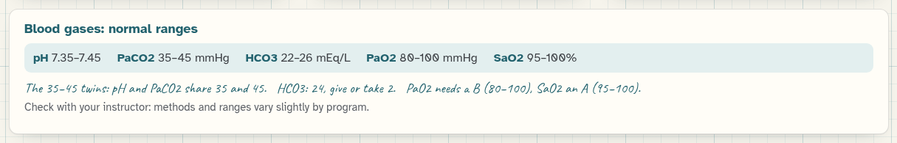
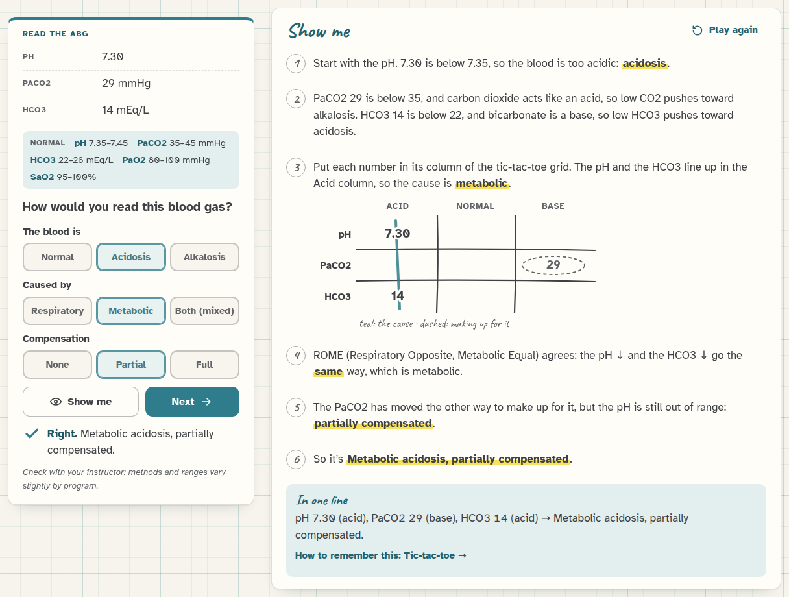
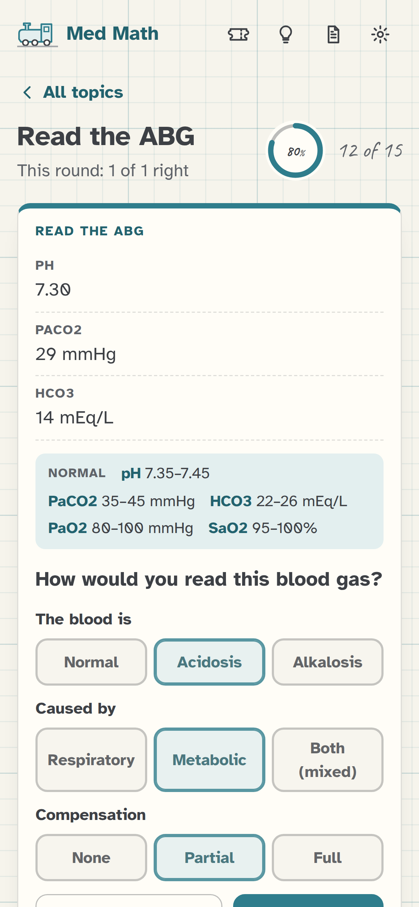
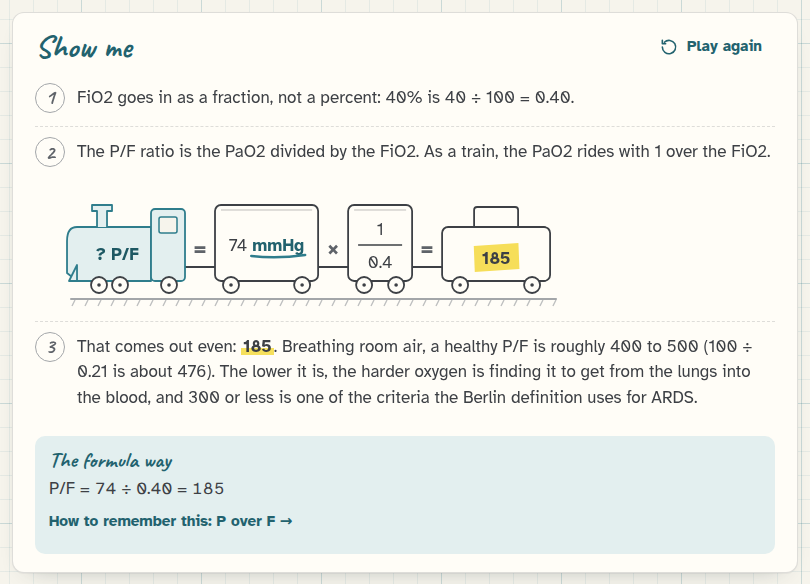
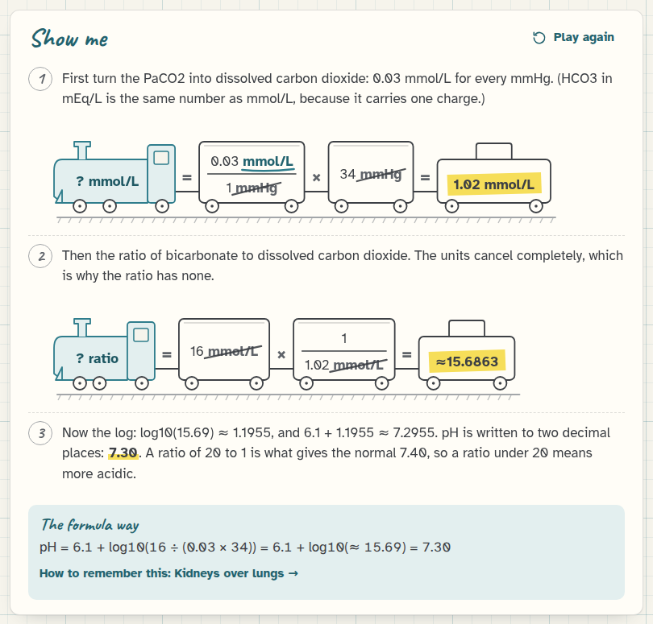
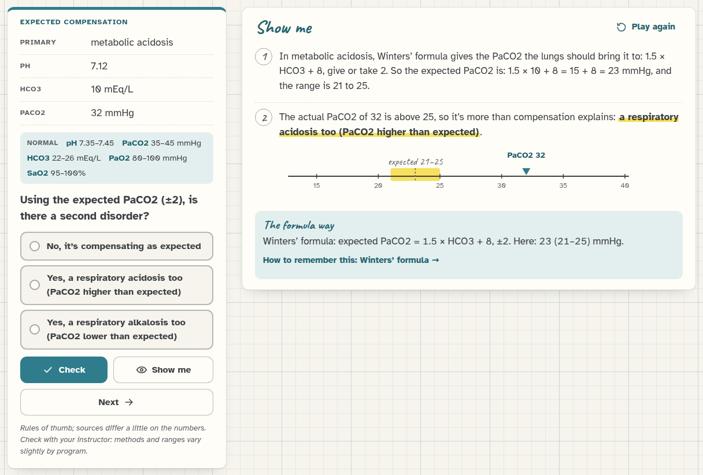
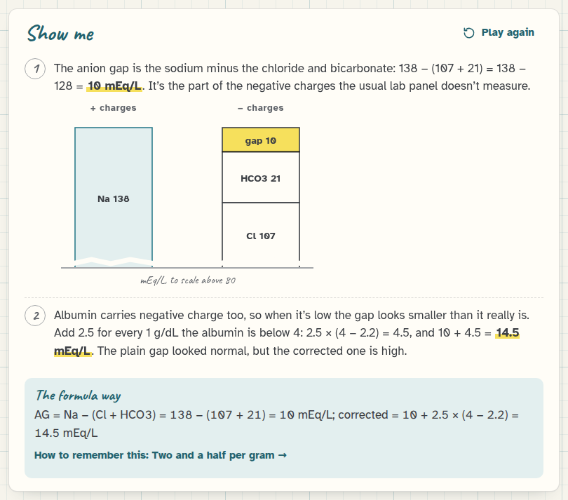
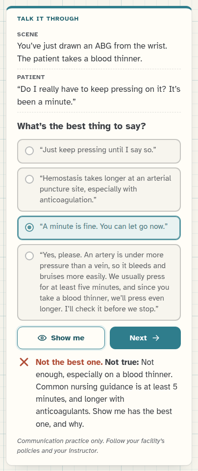
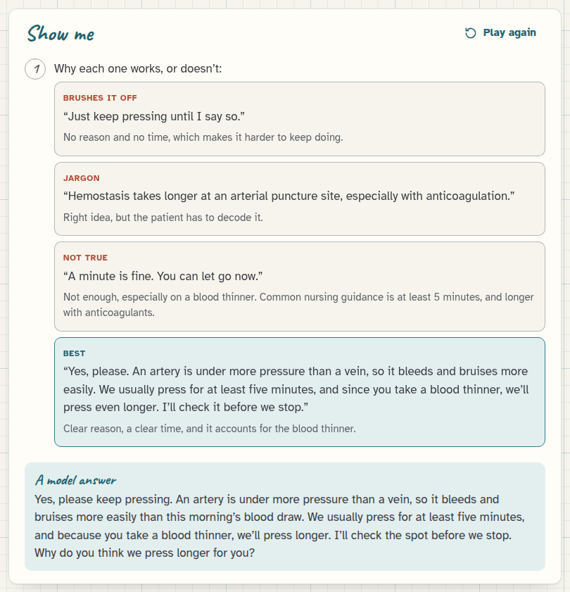

[Med Math docs](README.md) › Blood gases

# Blood gases

Arterial blood gases are the other kind of math nursing students get tested on, so Med Math has a whole section for
them. It's the "Blood gases" box on the home screen, with six topics and a **Blood gas quiz** of its own. It works
like the rest of Med Math: endless problems, **Check**, **Show me** and **Next**, and every answer worked out step by
step. This page goes through the six topics and says where the numbers and the advice come from.

To get the ranges and formulas into your head in the first place, there's [Memorizing blood gases](memorize.md),
with a memory trick for each one and drills to make them stick.

One thing first, because it matters here even more than with doses: methods and normal ranges vary a little from
program to program and lab to lab. Every blood gas problem says so, and you should check with your instructor
whenever Med Math and your course disagree. Med Math uses the ranges most nursing courses teach, and they're printed
on every problem: pH 7.35 to 7.45, PaCO2 35 to 45 mmHg, HCO3 22 to 26 mEq/L, PaO2 80 to 100 mmHg and SaO2 95 to 100%.

*The normal ranges, as they appear on the formula sheet.*

## Read the ABG

You get a pH, a PaCO2 and an HCO3 (sometimes a PaO2 and SaO2 too), and you answer with three short choices: the
blood is **Normal**, **Acidosis** or **Alkalosis**, it's caused by **Respiratory**, **Metabolic** or **Both (mixed)**,
and the compensation is **None**, **Partial** or **Full**. Picking Normal turns the other two off, and picking mixed
turns compensation off, because there's nothing to pick there.

*7.30, 29 and 14: the pH and the HCO3 line up in the Acid column, so it's metabolic, and the low PaCO2 is the lungs making up for it.*

*On a phone, the three choices sit one above the other.*

**Show me** reads it both ways nursing courses teach. The tic-tac-toe way puts each number in a column, Acid, Normal
or Base (remembering that CO2 acts like an acid and bicarbonate like a base), and whichever number lines up with the
pH is the cause. Three in a row is mixed. ROME says the same thing in words: Respiratory Opposite (the pH and PaCO2
move opposite ways), Metabolic Equal (the pH and HCO3 move the same way). Then the compensation: if the other number
is still normal, it's uncompensated, if it has moved the other way but the pH is still out of range, it's partial,
and if the pH is back inside 7.35 to 7.45 it's full, and which side of 7.40 the pH is on tells you the cause.

The random ABGs aren't random numbers. Each one is built from a PaCO2 and an HCO3, with the pH worked out by the
Henderson-Hasselbalch equation, which means the three numbers always hang together the way real ones do.

## Oxygenation

Two kinds of problem. One asks how the oxygenation is, from the PaO2 and SaO2: **Normal**, **Low (hypoxemia)** or
**Higher than normal**, which usually means more oxygen than the patient needs. I left out labels like mild,
moderate and severe hypoxemia, because the sources I found don't agree on where those cutoffs are.

The other asks for the P/F ratio, the PaO2 divided by the FiO2. The FiO2 has to go in as a fraction, so 40% oxygen
is 0.40, and Show me does that step first when the problem gives a percent. On room air a healthy P/F is about 400
to 500, and 300 or less is one of the criteria the Berlin definition of ARDS uses.

*PaO2 74 on 40% oxygen: a P/F of 185.*

## The equation

Henderson-Hasselbalch: pH = 6.1 + log10(HCO3 ÷ (0.03 × PaCO2)). You get the HCO3 and PaCO2 and work out the pH, which
is always written with two decimal places (7.40, not 7.4, though both count as right).

*The trains turn the PaCO2 into dissolved CO2, then the ratio, where the units cancel completely.*

Show me does it in three steps: the PaCO2 times 0.03 gives the dissolved carbon dioxide, the HCO3 over that gives the
ratio, and 6.1 plus the log of the ratio gives the pH. HCO3 24 and PaCO2 40 give a ratio of exactly 20 to 1, which is
where the normal 7.40 comes from. The answer key isn't worked out with a calculator's log at all: Med Math decides
the rounding with whole numbers, exactly, and checks it against an ordinary calculation.

## Expected compensation

These are the rules of thumb for "is the body compensating as much as it should, or is there a second problem?":

- **Metabolic acidosis,** Winters' formula: expected PaCO2 = 1.5 × HCO3 + 8, give or take 2. HCO3 12 gives 26 (24 to 28).
- **Metabolic alkalosis:** expected PaCO2 = 40 + 0.7 × (HCO3 − 24), give or take 2.
- **Respiratory acidosis:** the HCO3 rises about 1 (acute) or 3.5 (chronic) for every 10 mmHg the PaCO2 is above 40.
- **Respiratory alkalosis:** the HCO3 falls about 2 (acute) or about 4 (chronic) for every 10 mmHg it's below 40.

Some problems ask for the expected value (the middle of the range), and some give you the whole ABG and ask if
there's a second disorder. Med Math keeps the actual value clearly inside or clearly outside the ±2 range, so there's
never an argument about a borderline case. The sources don't all use the same chronic numbers (some say 4 for
chronic respiratory acidosis, or 5 for chronic respiratory alkalosis), which is one more place to follow your course.

*Expected 21 to 25, actual 32: the lungs aren't keeping up, which is a respiratory acidosis on top.*

## Anion gap

AG = Na − (Cl + HCO3), and normal is about 8 to 12 mEq/L, though labs vary. Problems ask for the gap, whether it's
high, or the albumin-corrected gap, which adds 2.5 for every 1 g/dL the albumin is below 4. Show me draws the
charges as two columns, sodium on one side and chloride, bicarbonate and the gap on the other, so you can see what
"the gap" actually is.

*A gap of 10 looks normal, but with an albumin of 2.2 the corrected gap is 14.5.*

## Talk it through

This one isn't math. It's practice for the part of the job where you explain things to patients and families, and
every card is a moment at the bedside: a patient asking why the blood has to come from the wrist, why it hurts more,
what you're checking when you press on their wrist (the modified Allen test), what "too acidic" means, why their
oxygen was turned down, why they have to keep pressing on the site and what to watch for afterwards, and a family
member asking what the numbers mean.

*Picking a weaker answer tells you why it's weaker.*

You pick the best thing to say out of three or four. Each answer gets a label, like **Jargon**, **False
reassurance**, **Too much detail**, **Brushes it off** or **Doesn't check understanding**, and a sentence on why.
Show me lists them all and ends with a model answer, which usually finishes with a teach-back question ("Can you
tell me in your own words…?"). While a card is open, the side panel has plain words for pH, carbon dioxide,
bicarbonate, oxygen, acidosis, alkalosis and compensation.

*Every option explained, the best one in teal, and a model answer at the end.*

These cards are communication practice and nothing more. They don't give treatment advice for a real person, and
details like how long to hold pressure follow common nursing guidance, which your facility's policy overrides. I've
written down every fact the cards rely on, and where it comes from, in REVIEW.md in the repo, so an instructor or a
nurse can check them.

## How sure can you be of the answers?

The same as for the doses. Every calculation and every reading is worked out twice, in two separate pieces of code:
the ABG reading once by tic-tac-toe and once by ROME, the equations once with exact fractions and once as ordinary
formulas. The tests check the worked examples from my checklist exactly (7.30, 50 and 24 is an uncompensated
respiratory acidosis, 7.37, 55 and 31 a fully compensated one, 7.25, 60 and 18 a mixed acidosis, HCO3 24 and PaCO2 40
give 7.40, Winters' for HCO3 12 gives 26, Na 140, Cl 104 and HCO3 12 give a gap of 24, and so on). Then they make
thousands of random problems and check both ways agree on every one, that every random ABG fits the
Henderson-Hasselbalch equation within 0.03, and that both ways of reading give the same answer for every combination
of pH, PaCO2 and HCO3 on a grid of over 350,000 of them.

## Sources

These are what I relied on. Where they differ, the page above says so.

- **Normal ranges:** the ones most nursing courses teach. MedlinePlus lists slightly different ones and notes that
  ranges vary between labs.
- **MedlinePlus, "Blood gases"** (U.S. National Library of Medicine): what the test is, that the sample usually comes
  from an artery, that it tends to hurt more than a blood draw from a vein, and that circulation to the hand may be
  checked before a sample from the wrist.
- **AARC Clinical Practice Guideline: Blood Gas Analysis and Hemoximetry: 2013,** M. D. Davis, B. K. Walsh, S. E.
  Sittig and R. D. Restrepo, *Respiratory Care* 58 (2013), pp. 1694–1703.
- **Henderson-Hasselbalch with 6.1 and 0.03:** standard physiology, for example the acid-base chapters of Guyton and
  Hall's *Textbook of Medical Physiology*.
- **Winters' formula:** M. S. Albert, R. B. Dell and R. W. Winters, "Quantitative displacement of acid-base
  equilibrium in metabolic acidosis", *Annals of Internal Medicine* 66 (1967), pp. 312–322.
- **Expected compensation:** K. Berend, A. P. J. de Vries and R. O. B. Gans, "Physiological approach to assessment of
  acid-base disturbances", *New England Journal of Medicine* 371 (2014), pp. 1434–1445. Other reviews and course
  materials use slightly different chronic factors.
- **Anion gap:** J. A. Kraut and N. E. Madias, "Serum anion gap: its uses and limitations in clinical medicine",
  *Clinical Journal of the American Society of Nephrology* 2 (2007), pp. 162–174, and for the albumin correction,
  J. Figge, A. Jabor, A. Kazda and V. Fencl, "Anion gap and hypoalbuminemia", *Critical Care Medicine* 26 (1998),
  pp. 1807–1810.
- **P/F ratio and ARDS:** The ARDS Definition Task Force, "Acute respiratory distress syndrome: the Berlin
  Definition", *JAMA* 307 (2012), pp. 2526–2533.
- **SaO2 to go with a PaO2:** J. W. Severinghaus, "Simple, accurate equations for human blood O2 dissociation
  computations", *Journal of Applied Physiology* 46 (1979), pp. 599–602.
- **Teach-back:** the AHRQ Health Literacy Universal Precautions Toolkit, Tool 5, "Use the Teach-Back Method".
- **ROME, tic-tac-toe, the modified Allen test, and holding pressure** (at least 5 minutes, longer on blood thinners):
  common nursing teaching and procedure guidance. Facility policies differ, especially on timings.

## Next step

Open **Read the ABG** and do ten in a row, pressing **Show me** whenever the tic-tac-toe grid would have helped, then
try the **Blood gas quiz**.

Next: [Memorizing blood gases](memorize.md) →
