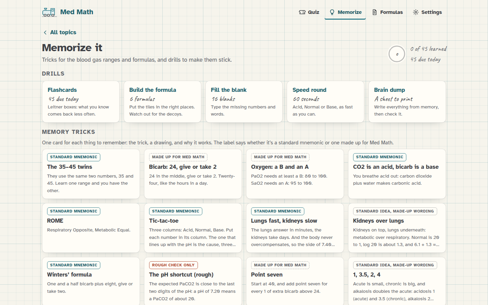
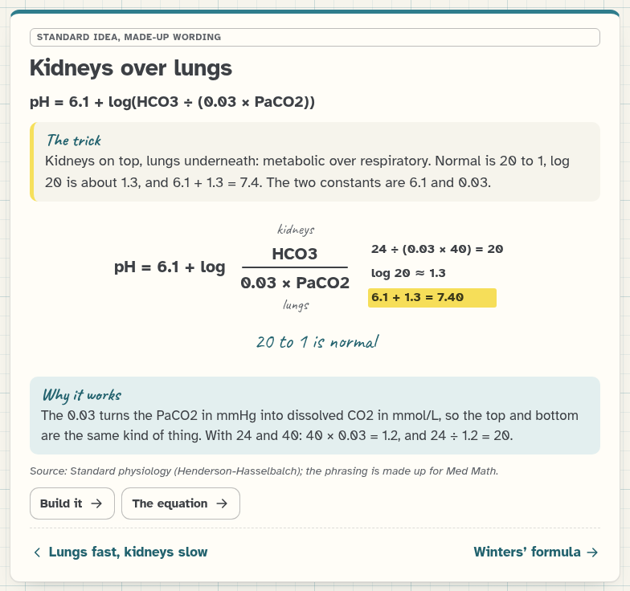
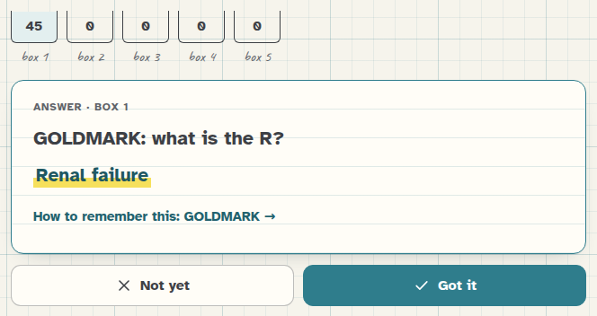
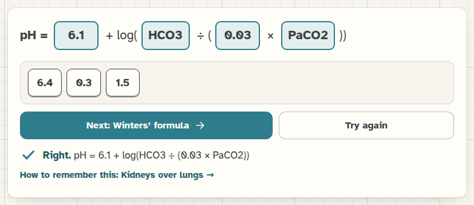
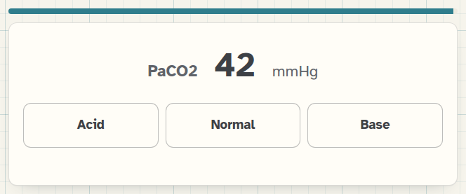

[Med Math docs](README.md) › Blood gases

# Memorizing blood gases

Most of a blood gas exam is knowing a handful of numbers and formulas cold: the normal ranges, Winters' formula, the
anion gap and so on. Working them out doesn't help if you can't remember them, so Med Math has a part just for
that, called **Memorize it**. It's in the Blood gases box on the home screen and in the bar at the top, and it has
two halves: memory tricks, and drills to make them stick.

*The drills at the top, and one card for each thing to remember underneath.*

## The memory tricks

There's one card for each thing to remember, eighteen in all: the 35–45 twins, bicarb's 24 give or take 2, the oxygen
grades, why CO2 is an acid, ROME, tic-tac-toe, how compensation works, Henderson-Hasselbalch, Winters' formula, the
pH shortcut, metabolic alkalosis, the respiratory rules, the anion gap and its albumin correction, MUDPILES,
GOLDMARK, the P/F ratio and the Allen test.

Each card has the thing itself, the trick, a small drawing, and a line on WHY the trick works, which is the part I
care about most, because a trick you understand is one you don't forget the night before the exam. The drawings
aren't decoration either: the oxygen curve is the real curve, and the pH shortcut's chart is worked out from Winters'
formula and Henderson-Hasselbalch.

*Henderson-Hasselbalch: kidneys on top, lungs underneath, and 20 to 1 is normal.*

Every card says what kind of trick it is, so you know what you're memorizing:

- **Standard mnemonic** is something nursing courses and textbooks teach, like ROME, tic-tac-toe, MUDPILES and
  GOLDMARK (GOLDMARK is the newer list and the one to learn if your course allows).
- **Made up for Med Math** is a hook I invented, like "PaO2 needs a B, SaO2 needs an A". The numbers are standard,
  only the way of remembering them is mine.
- **Standard idea, made-up wording** is in between.
- **Rough check only** is the pH shortcut, and it gets its own section below.

From any blood gas problem, **Show me** ends with a link, "How to remember this", to the trick for that formula, and
the formula sheet has a short hook next to each blood gas formula, which links to its card too.

## The pH shortcut, honestly

Students often learn that in metabolic acidosis the expected PaCO2 is about the last two digits of the pH, so a pH
of 7.25 means a PaCO2 of about 25. I checked it against Winters' formula and Henderson-Hasselbalch, using the pH the
way it's written (two decimals), and it's only rough. From pH 7.13 to 7.33 it lands within about 3.5 mmHg of
Winters' (the worst is 3.6, around 7.26), and outside that it drifts off fast: about 4.7 mmHg off at 7.10 and 4.3 at
7.34. Funnily enough the classic example, 7.25, is close to where it's worst, so the card uses 7.20 instead. Basically,
use Winters' for the answer and the shortcut only to catch a big mistake.

## The drills

**Flashcards** cover every range, formula, constant, rule and mnemonic letter, 45 cards in all. Press **Show the
answer** (or Space), then **Got it** (G) or **Not yet** (N). They're sorted into Leitner boxes 1 to 5: a card you get
right moves up a box and comes back after 1, 2, 4, 8 and then 16 days, and a card you miss goes back to box 1 and
comes round again before the round ends. A card in box 3 or higher counts as learned, and the home screen shows how
many you've learned and how many are due today. When nothing is due, **Practice all 45 anyway** runs the whole deck.

*The five boxes, and a card with its answer and the trick that goes with it.*

**Build the formula** gives you the formula with empty slots and a tray of tiles, including a few decoys like 6.4
next to 6.1, or 0.7 next to 1.5. Tap a tile to drop it in the next empty slot, or drag it into a slot, and tap a slot
to take a tile back out. It works with a mouse, a finger or the keyboard. There are six: Henderson-Hasselbalch,
Winters', metabolic alkalosis, the anion gap, the albumin correction and the P/F ratio. Your answer is checked by
working it out at several realistic sets of values and comparing it with what the problems themselves use, which
means 0.03 × PaCO2 and PaCO2 × 0.03 both count, but a decoy never does.

*Henderson-Hasselbalch built, and 6.4, 1.5 and 0.3 left behind.*

**Fill the blank** is the same thing typed: "Expected PaCO2 = 1.5 × ___ + ___ ± ___". Numbers can be written any way
(.7 or 0.7), and words have a few spellings (HCO3, bicarb, bicarbonate).

**Speed round** is 60 seconds of single values, a pH, a PaCO2 or an HCO3, and you tap **Acid**, **Normal** or
**Base** (or press A, N or B), as many as you can. It's there to make the first step of tic-tac-toe automatic,
especially the backwards one: a HIGH PaCO2 is on the acid side. Your best score is saved.

*A PaCO2 of 42: inside 35 to 45, so Normal.*

**Brain dump** is a sheet to print, with a box for every range, formula and mnemonic and nothing filled in. A lot of
students write all of it down the moment an exam starts, so practicing that habit is worth it. The answer key prints
on a page of its own after the sheet.

## How sure can you be?

The same as everywhere else in Med Math. Every number on the cards, the tiles, the blanks and the speed round comes
from the same place the problems get theirs, and the tests read the numbers back out of the problem functions
themselves and check every flashcard, every tile solution (including that no arrangement with a decoy passes), every
blank, 3,000 speed-round values and the pH shortcut's numbers above.

## Sources

The trick sources are on [Blood gases](blood-gases.md#sources), plus StatPearls ("Allen Test") for the 5 to 15
seconds, and A. N. Mehta, J. B. Emmett and M. Emmett, "GOLD MARK: an anion gap mnemonic for the 21st century",
*The Lancet* 372 (2008), p. 892. ROME, tic-tac-toe, MUDPILES and the 35–45 twins are long-standing teaching
mnemonics. REVIEW.md in the repo says which tricks are standard and which I made up.

## Next step

Do today's flashcards, then one speed round, and print a brain dump to try at the end of the week.

Next: [The 14 topics](topics.md) →
