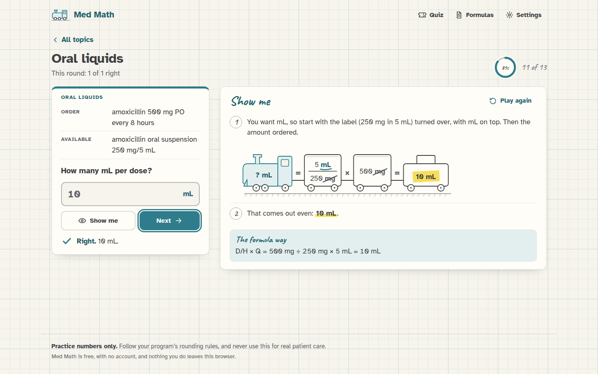
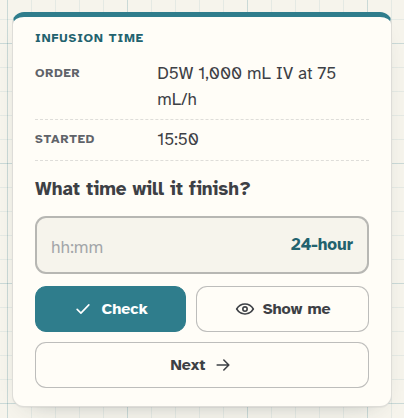
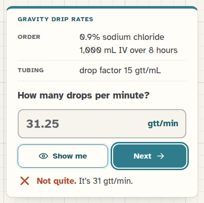

[Med Math docs](README.md) › Using Med Math

# Practicing a topic

This page is about the practice screen: how a problem is laid out, how to answer it, what counts as right, and how
your progress is kept. The drawings in **Show me** have their own page, [How the train works](the-train.md).

## Picking a topic

The home screen has the 14 topics on four "lines", like a train map: Conversions, Tablets, liquids and shots, By
weight, and IV lines. Each topic is a station with a ring that shows how many you've got right so far, and "new" if
you haven't tried it yet. Tap one and you're straight into its first problem. Each topic is endless, so you can stay
as long as you like, and **All topics** at the top takes you back.

## The problem

Every problem is laid out like an order sheet. The top lines are what you'd see on the job: the **Order**, what's
**Available**, the **Patient** weight, the **Bag** or the **Vial** label, the **Tubing**. Then comes the question,
in bold, and the answer box, which already shows the unit the answer should be in. That's a small hint on purpose,
because knowing the unit you're after is the first step of every problem.

*A problem, answered and checked, with Show me open beside it.*

Some topics have a different kind of answer box:

- **Safe-dose check** has three choices instead of a box: "Yes, it's safe", "No, too low" and "No, too high".
- **Infusion time** asks either how long something takes, with a box for hours and a box for minutes, or what time
  it finishes, with one box for the clock time.

*A finish-time problem. The box takes 24-hour time unless you switch the clock in Settings.*

- The weight-based, safe-dose, titration and BSA problems have a note under them saying the numbers are for practice
  only, and the safe-dose ones also say the safe range is part of the problem. It's stated right in the problem, so
  you don't need to know any real drug's range.

## Check, Show me and Next

Type your answer and press **Check**, or just press Enter. If it's right, you get a teal check mark and the answer.
If it isn't, you get "Not quite." with the right answer, and **Show me** gets a little ring around it to say it's
worth a look. Press **Next** (or Enter again) for a new problem.

*31.25 is the unrounded answer, but you can't count a quarter of a drop, so it's not quite right.*

**Show me** works any time. If you open it before you've checked your answer, that problem simply isn't counted in
your progress, and the message after you check says "(Not counted, since you looked first.)". This way peeking never
costs you anything, but it doesn't count as a right answer either.

## What counts as right

The key is the answer rounded the way the topic's rule says (the rules are in [Settings](settings.md)), and you're
marked right when your answer is that number. A few things are fine on top of that:

- **Any way of writing the number.** 0.5, .5, 0.50, 1/2 and ½ are all the same. Commas in big numbers are fine
  (25,000), and so is the unit typed after the number ("10 mL").
- **More decimals than needed,** as long as it really is the unrounded answer. If the key is 133.3 mg, then 133.33
  counts too, and the message says what it rounds to. This doesn't apply to tablets or drops, because you can't give
  0.48 of a tablet or count a quarter of a drop.
- **Not rounding along the way.** Med Math rounds the weight in kg first (that's what most courses teach), but if you
  kept the unrounded weight all the way through and got a slightly different answer, that counts too, and the
  message says "That works." and shows the usual answer. The same goes for rounding a dose before turning it into
  mL, or using the BSA before rounding it.
- **Clock times** can be written 15:30, 1530 or 3:30 PM. If your clock setting is 12-hour, 3:30 without AM or PM
  counts for either half of the day.

## Your progress

Every answer you check is counted for its topic (unless you looked first), and the ring on the home screen shows
your percentage, with "8 of 10" next to it. The practice screen also shows how this round is going, and at the
bottom of the home screen there's a strip of your last 50 answers, teal for right and a red cross for a miss, which
is a quick way to see if you're getting better.

All of it is kept in your browser, and **Reset progress** in [Settings](settings.md) starts every topic fresh.

## On the keyboard

On a computer you never need the mouse: the answer box is ready as soon as the problem appears, Enter checks, and
Enter again goes on to the next one. Tab moves between the buttons, and in the safe-dose choices the arrow keys move
between the three answers.

## Next step

Get one wrong on purpose, then press **Show me** and read [How the train works](the-train.md) alongside it.

Next: [How the train works](the-train.md) →
