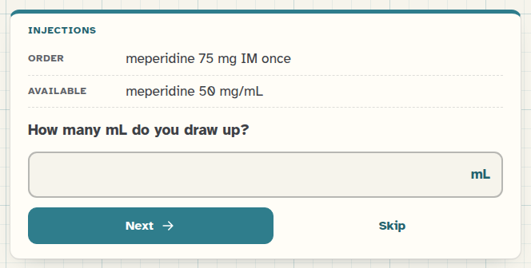
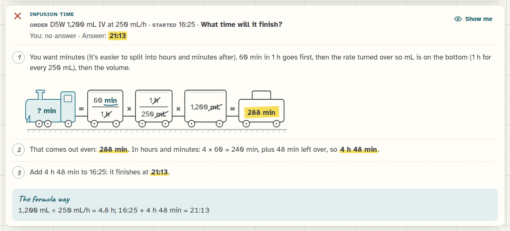

[Med Math docs](README.md) › Using Med Math

# The quiz and the formula sheet

The **Mixed quiz** is 10 problems from different topics, the closest thing in Med Math to the real exam. The
**Formula sheet** is everything on one card, to read on screen or print. Both are on the home screen and in the bar
at the top.

## Taking a quiz

A quiz picks 10 problems spread over the topics you've chosen in [Settings](settings.md) (all 14 unless you've
changed it), so you won't get three heparin problems in a row. The row of little tickets at the top shows where you
are.

*Problem 1 of 10. You'll see how you did at the end.*

Unlike practice, the quiz doesn't tell you whether each answer is right as you go, which is how an exam works.
Type the answer and press **Next** (or Enter), and the last one says **Finish**. **Skip** moves on without an answer,
and a skipped problem counts as a miss. Every answer in a quiz also counts towards your progress for its topic.

## The results

At the end you get your score, circled in pencil, and a list of all ten problems with what you answered. The misses
have a red cross and the right answer under a highlighter, and every problem, right or wrong, has a **Show me** that
opens its train right there in the list.

*8 out of 10, with the two misses ready to try again.*

**Retry the misses** gives you just the problems you missed, with the same numbers, so you can try them again after
looking at the trains. **New quiz** makes a fresh set of 10.

*A miss, opened in the results.*

## The formula sheet

The formula sheet has every formula Med Math uses, written out with proper fractions: the train itself with an
example, desired over have, IV pump rates, gravity drips, infusion time, weight-based doses, the safe-dose check,
reconstitution, heparin, titrations and BSA. There's a table of conversions, and a card with your own rounding rules,
which follows your settings, so if you switch pump rates to whole numbers the sheet says so too.

*The whole formula sheet.*

**Print** prints it on about two pages, without the buttons and the graph paper, which makes a decent study card to
keep in a binder. Basically, it's the cheat sheet you're not allowed to bring to the exam, to learn from before it.

## Next step

Take one quiz with all 14 topics on, and then press **Retry the misses** after you've looked at the trains.

Next: [The 14 topics](topics.md) →
