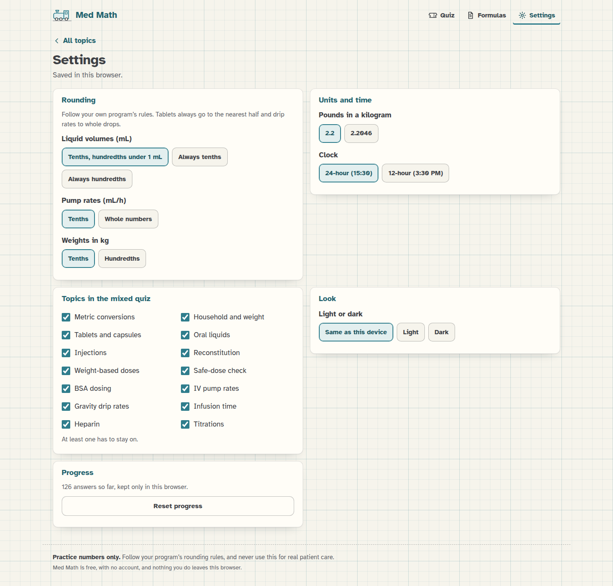

[Med Math docs](README.md) › Reference

# Settings

Settings is the gear at the top of every screen. Everything there is saved in your browser as soon as you change it,
and there's no Save button. When you change a rounding rule, the problem you were on is swapped for a new one, which
means an answer key never mixes the old rule and the new one.

*Settings, with the defaults.*

## Rounding

Programs don't all round the same way, so these three are up to you. Follow your own program's rules.

- **Liquid volumes (mL):** "Tenths, hundredths under 1 mL" (the default, so 1.25 becomes 1.3 and 0.375 becomes 0.38),
  "Always tenths" or "Always hundredths". This is used for oral liquids, injections, reconstitution and any other
  answer in mL.
- **Pump rates (mL/h):** "Tenths" (the default) or "Whole numbers", for pumps that only take whole mL/h.
- **Weights in kg:** "Tenths" (the default) or "Hundredths". This is the rule for turning pounds into kg, both as an
  answer and as the first step of a weight-based problem.

Some rules stay the same: tablets to the nearest half, drip rates to
whole drops, heparin units to whole units, BSA to hundredths, times to the nearest minute, and doses in mg and
mcg/kg/min to tenths. Everything rounds half up, and only at the end of a train, except the weight in kg and the BSA, which are
rounded before they're used.

## Units and time

- **Pounds in a kilogram:** 2.2 (the default) or 2.2046. It's used for every pound-to-kg step and shows up on the
  formula sheet.
- **Clock:** "24-hour (15:30)" or "12-hour (3:30 PM)". This changes how times are written in the infusion-time
  problems, and with the 12-hour clock a time typed without AM or PM counts for either half of the day.

## Topics in the mixed quiz

All 14 are on to start with. Turn off the ones you don't need yet, and the next quiz only uses the ones that are on.
At least one has to stay on.

## Look

"Same as this device" follows your phone or computer's light or dark setting, and "Light" and "Dark" stick to one.

## Progress

**Reset progress** clears every topic's score and your last 50 answers. It asks you to tap again before it does
anything, because it can't be undone. Settings aren't touched.

If the browser won't let Med Math save anything (some private windows), Settings says so at the top, and your
settings and progress last until you close the page.

## Next step

Set the rounding to match your program's rules before you start practicing, and you're ready.

Next: [Developing](DEVELOPING.md) →
