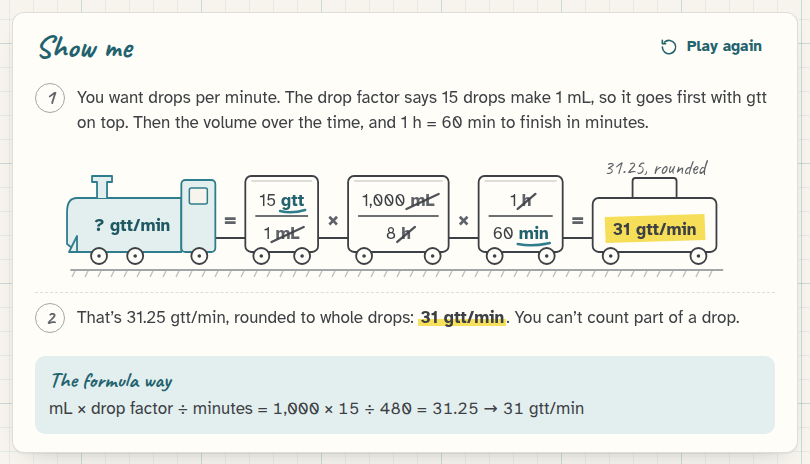
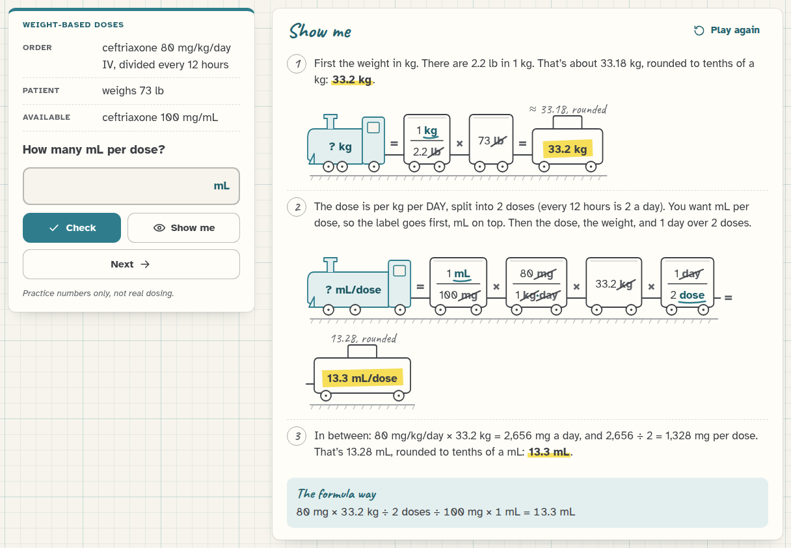
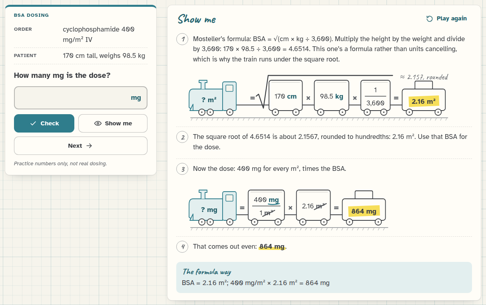

[Med Math docs](README.md) › Using Med Math

# How the train works

Every "Show me" in Med Math is a train, and this page explains how to read one. It's dimensional analysis, the
method most nursing courses teach, just drawn so you can see it happen.

## The idea in one sentence

You start with the unit you want, then line up fractions so every unit you don't want shows up once on top and once
underneath, which makes it cancel, and whatever is left at the end is the answer's unit. If the units come out
right, the setup is right, and the arithmetic is just multiplying across the top and dividing by the bottom.

*1,000 mL over 8 hours with 15 gtt/mL tubing. mL, h and the rest cancel, and gtt/min is what's left.*

## The pieces

- **The engine** carries a question mark and the unit you're after, like "? gtt/min". That's always where you start.
- **Each car is a fraction.** The first car usually has the unit you want on top: for a drip rate that's the drop
  factor, 15 gtt over 1 mL. Conversion facts are cars too (1 h over 60 min, 1 mg over 1,000 mcg), and the amount
  that was ordered rides in a car of its own with nothing underneath.
- **The pencil strokes** go through every unit that cancels: one on top in one car, the same one underneath in
  another. When the animation runs, the strokes are drawn one pair at a time, after all the cars have rolled in.
- **The teal underline** marks the units that didn't cancel. Those are the answer's units, and they should match the
  engine.
- **The caboose** carries the answer, under a yellow highlighter. If it had to be rounded, a pencil note above it
  says the unrounded number, like "31.25, rounded".

On a phone, or when a train is long, it carries on to a second track. The "×" or "=" at the end of the first track
is where it continues.

## The steps around the train

The train is one step in a short list. Before it, a sentence says why the cars are in that order ("You want drops
per minute. The drop factor says 15 drops make 1 mL, so it goes first…"). After it, the rounding is said in words:
"That's 31.25 gtt/min, rounded to whole drops: 31 gtt/min." When nothing needs rounding it says "That comes out
even".

Some problems have more than one train. A weight given in pounds gets its own little train first (1 kg over 2.2 lb,
times the weight), and the rounded kg goes into the dose train. Reconstitution works out the concentration first and
then the volume, and a safe-dose check has one train for each end of the safe range and one for what the order adds
up to.

*Pounds to kg first, then the dose per day split into doses, then the mL.*

## The formula way

Under the steps there's a teal box called "The formula way", with the same answer done with the usual formulas: D/H
× Q for tablets and liquids, mL × drop factor ÷ minutes for drips, and so on. It's there so you can check the train
against the method you might have learned first, and the other way around. They always agree, because Med Math
actually works every answer out both ways and a test checks that they match.

## The one that's different: BSA

Body surface area by Mosteller's formula is √(cm × kg ÷ 3,600). That's a formula and not a chain of units that
cancel, so the BSA train runs under a square root sign and nothing gets struck through. The next train then uses
the BSA, rounded to hundredths, for the dose in mg/m², and that one cancels like any other.

*The BSA train under its square root, then the dose.*

## Watching it again

**Play again** at the top of Show me runs the animation from the start. If your device is set to reduce motion, the
trains are drawn complete straight away, with nothing rolling in.

## Next step

Open a topic you know well, press **Show me** before you answer, and check that the train matches the way you'd set
it up yourself. Then try the [quiz](quiz-and-formulas.md).

Next: [The quiz and the formula sheet](quiz-and-formulas.md) →
