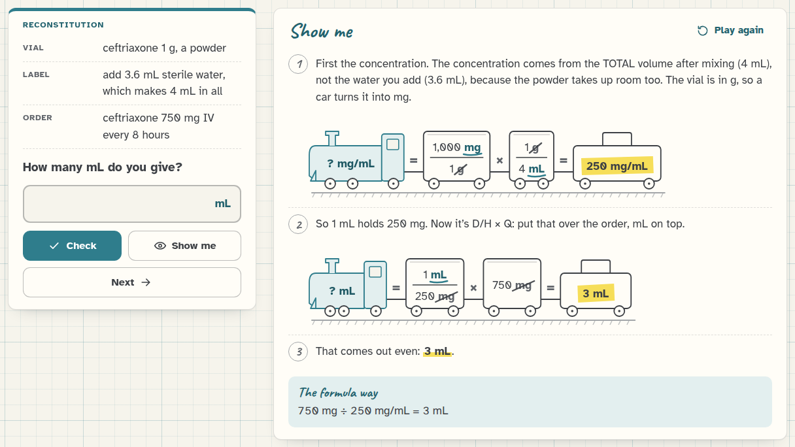
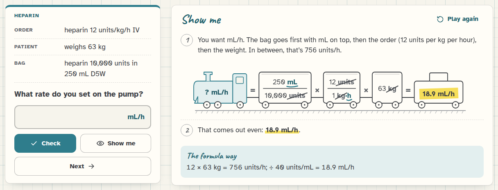

[Med Math docs](README.md) › Reference

# The 14 topics

This is the list of every dosage topic, what kind of problem it makes, an example, and how its answer is rounded.
The six blood gas topics are on their own page, [Blood gases](blood-gases.md). The
rounding rules marked "(setting)" can be changed in [Settings](settings.md), and everything rounds half up, so 31.25
becomes 31 and 62.5 becomes 63.

## Conversions

- **Metric conversions.** g, mg and mcg, L and mL, and newborn weights between kg and g. Some are plain ("Convert
  0.25 g to mg"), some are an order ("levothyroxine 88 mcg PO daily. How many mg is that?"). The answers are exact,
  so there's nothing to round.
- **Household and weight.** Teaspoons (5 mL), tablespoons (15 mL) and ounces (30 mL), pounds and kilograms, inches
  and centimeters (2.54 cm to the inch). Example: a patient who weighs 181 lb is 82.3 kg. Weights in kg round by the
  kg rule (setting), and everything else to tenths.

## Tablets, liquids and shots

- **Tablets and capsules.** D/H × Q, where Q is one tablet. Answers are between half a tablet and 3, capsules are
  always whole, and sometimes the order is in another unit (mcg against mg, g against mg). Example: digoxin 0.125 mg
  ordered, 0.25 mg tablets on hand, is 0.5 tablet. Always to the nearest half tablet.
- **Oral liquids.** D/H × Q in mL, from suspensions and solutions like 250 mg/5 mL or 20 mEq/15 mL. Example:
  amoxicillin 500 mg ordered, 250 mg/5 mL on hand, is 10 mL. Liquid rule (setting).
- **Injections.** How many mL to draw up: up to 3 mL for IM and subcut, up to 5 mL IV. Some are in mcg or units.
  Examples: 75 mg ordered from 50 mg/mL is 1.5 mL, and 0.3 mg from 0.5 mg/mL is 0.6 mL. Liquid rule (setting).
- **Reconstitution.** A vial of powder and its label ("add 3.6 mL sterile water, which makes 4 mL in all"). It asks
  either for the concentration once it's mixed, or for the mL to give. The concentration always comes from the
  total volume, not the water added. Example: ceftriaxone 1 g in 4 mL is 250 mg/mL, so 750 mg is 3 mL. The
  concentration rounds to tenths, the mL by the liquid rule (setting).

*Reconstitution: the concentration from the label first, then the mL to give.*

## By weight

- **Weight-based doses.** mg/kg per dose, or mg/kg/day divided every 6, 8 or 12 hours, with the weight in kg or lb.
  It asks for mg per dose or mL per dose. Example: a child of 44 lb is 20 kg, 20 mg/kg/day is 400 mg a day, and
  divided every 8 hours that's 133.3 mg per dose. The weight is rounded by the kg rule (setting) before it's used,
  mg round to tenths and mL by the liquid rule (setting).
- **Safe-dose check.** The order, the weight and the safe range, which is stated in the problem ("Safe range: 25–50
  mg/kg/day"), so no real drug's range is being claimed. You work out the low and high end for this patient, compare
  the ordered amount (per day or per dose, the same way as the range) and answer "Yes, it's safe", "No, too low" or
  "No, too high". The problems stay clear of the edges: the ordered amount is at least 3% away from either end of the
  range, however the weight is reasonably rounded, so there's never an argument about a borderline case.
- **BSA dosing.** Body surface area by Mosteller's formula, √(cm × kg ÷ 3,600), rounded to hundredths, and doses in
  mg/m², rounded to tenths. Example: 165 cm and 60 kg is 1.66 m².

## IV lines

- **IV pump rates.** mL/h from a volume over hours or minutes, or from a dose order like 10 mg/h, 6 units/h, 2 g/h,
  10 mEq/h or 1 mg/min with the bag's strength. Example: 1,000 mL over 8 hours is 125 mL/h. Pump rule (setting).
- **Gravity drip rates.** gtt/min with drop factors of 10, 15, 20 and 60 gtt/mL, from a volume over a time or from a
  rate in mL/h. Microdrip (60) only comes up for rates up to 100 mL/h, which is what it's used for. Examples: 1,000 mL
  over 8 hours with 15 gtt/mL is 31.25, so 31 gtt/min, and 100 mL over 30 minutes with 20 gtt/mL is 66.7, so 67
  gtt/min. Always whole drops.
- **Infusion time.** How long a bag takes (in hours and minutes), or what time it finishes on the clock, from a pump
  rate or a gravity drip. Some start from "mL left in the bag" and the time now. Example: 1,000 mL at 125 mL/h takes
  8 h, so started at 07:00 it finishes at 15:00. The problems are made to come out in whole minutes.
- **Heparin.** units/h to mL/h, mL/h back to units/h, a weight-based bolus (in units, or in mL from the vial), and a
  weight-based infusion in units/kg/h. Example: 25,000 units in 250 mL is 100 units/mL, so 1,000 units/h is 10 mL/h.
  mL/h by the pump rule (setting), units to whole units, bolus mL by the liquid rule (setting).

*A weight-based heparin infusion.*
- **Titrations.** mcg/kg/min or mcg/min to mL/h, and back from the pump rate to the dose. Example: dopamine 400 mg
  in 250 mL is 1,600 mcg/mL, 5 mcg/kg/min for 80 kg is 400 mcg/min, and that's 15 mL/h. mL/h by the pump rule
  (setting), doses to tenths.

## About the drug names and numbers

The drug names are real generic names, used so the orders read like real ones. The strengths, doses and safe ranges
are PRACTICE numbers picked to make realistic, clean problems, and they're not dosing information for any drug.

## Next step

Pick the topic on this list you'd least like to see on the exam, and do ten of it in a row.

Next: [Settings](settings.md) →
