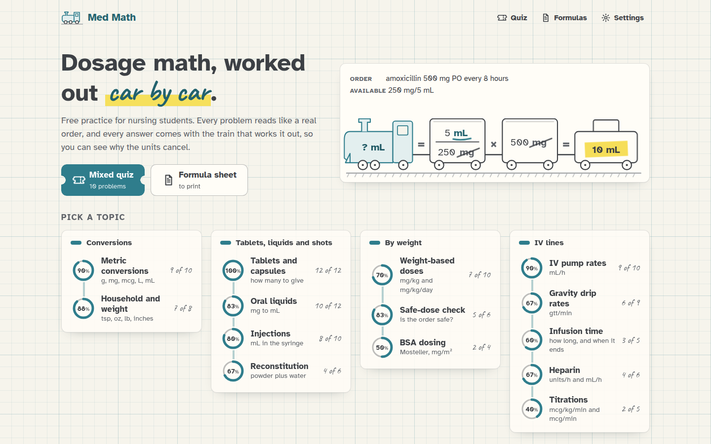
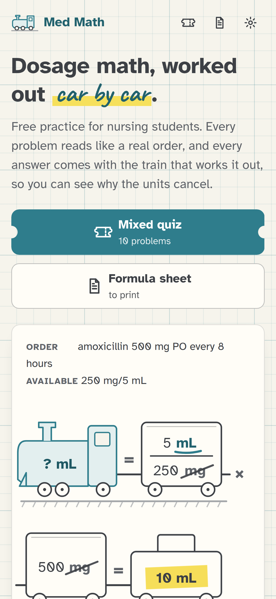

[Med Math docs](README.md) › Getting started

# What is Med Math?

Med Math is a web page for practicing dosage calculations, the kind nursing students get tested on: how many tablets,
how many mL, what rate to set on the pump, how many drops a minute, when the bag runs out. It makes a new problem
every time you ask, so it never runs out, and every answer comes with a "Show me" that works it out step by step.

*The home screen. Each topic has a ring that fills up as you get answers right.*

## What it does

You pick a topic, and Med Math writes a problem the way a real order reads: "Order: amoxicillin 500 mg PO every 8
hours. Available: amoxicillin oral suspension 250 mg/5 mL. How many mL per dose?" You type your answer in the box,
which already shows the unit, and press **Check** (or just Enter). If it's right, it says so. If it isn't, it tells
you the right answer and offers **Show me**.

**Show me** works the problem out with dimensional analysis, the method most nursing courses teach, where you line up
fractions until every unit you don't want cancels. I draw that as a train: the engine says what you're after, each
fraction is a car, the units that cancel get struck through in pencil, and the caboose carries the answer. Under the
train there's the same answer done "the formula way" (D/H × Q and friends), which means you can check one method
against the other.

There's also a **Mixed quiz** of 10 problems with a score at the end, and a **Formula sheet** you can print. Basically,
it's a practice book with an endless supply of problems, where every answer shows its working.

## Who it's for

Nursing students getting ready for a dosage calculation exam, and anyone who wants to keep these skills fresh. It
covers 14 topics, from metric conversions up to titrations in mcg/kg/min, and [The 14 topics](topics.md) lists them
all.

## How sure can you be of the answers?

A study tool with a wrong answer key is worse than no tool at all, so I took this part seriously. Every answer is
worked out twice, in two separate pieces of code that share nothing: once by multiplying the train out with exact
fractions, and once with the plain textbook formulas. Before anything goes live, a test makes thousands of random
problems in every topic and checks that both ways agree on every single one, that the units on each train really do
cancel to the answer's unit, and that the worked examples from my own checklist come out exactly right (500 mg from
250 mg/5 mL is 10 mL, 1,000 mL over 8 hours with a drop factor of 15 is 31 gtt/min, and so on).

The numbers are still PRACTICE numbers, though. The drug names are real generic names, so the problems feel real,
but the doses, concentrations and safe ranges are chosen for practice and aren't dosing advice. Programs also differ
on some rounding rules, which is why the rounding is in [Settings](settings.md). Follow your own program's rules, and
never use Med Math for real patient care.

## Where it works

Med Math is one web page, so it works the same in any up-to-date browser on a phone, a tablet or a computer. On a
computer you can do everything from the keyboard: type the answer, Enter to check, Enter again for the next one. On a
phone, the answer box brings up the number keyboard.

On an iPhone or iPad you can add it to the Home Screen (tap **Share**, then **Add to Home Screen**), and it opens with
its own icon like an app. On Android it's **Add to Home screen** in the browser menu.

<picture>
  <source media="(prefers-color-scheme: dark)" srcset="images/phone-home-dark.png">
  
</picture>

*On a phone, the topics are one long list under the example train.*

## What stays in your browser

Med Math doesn't have an account, a sign-in or a server that keeps anything. It loads its own files and that's it,
which means there's no tracking and nothing you type ever leaves your device. Your progress (right out of total for
each topic, and your last 50 answers) and your settings are kept in your browser's local storage.

That also means your progress doesn't follow you from your phone to your laptop, and clearing the site's data in the
browser wipes it. In a private window, or anywhere the browser won't keep storage, everything still works, and it
simply forgets when you close the page.

## Next step

Open **https://stuffs.tiresia.xyz/med-math/**, pick a topic you feel shaky on, and read [Practicing a
topic](practice.md) while the first problem is on the screen.

Next: [Practicing a topic](practice.md) →
